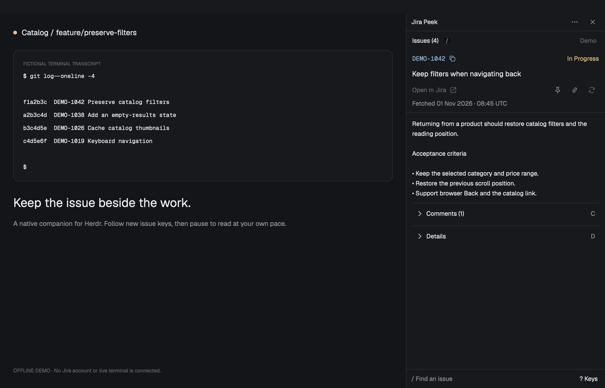

# Jira Peek for herdr-app

Jira beside your agents. A native panel attached to your existing Herdr window
that discovers issue keys in the focused terminal and keeps details within reach.

> **AI-assisted, experimental software — use with caution.** This mod was
> developed with AI assistance and is provided as-is, without warranty, under
> the [MIT License](LICENSE). Review the code and [known limitations](#known-limitations),
> test in an isolated Herdr app home, and back up your settings before connecting
> Jira. Grant only the access you need. Read the [security policy](SECURITY.md)
> for local credential and cache handling.
>
> **Contributions and issue reports are closed for now.** Collaboration, pull
> requests, bug reports, feature requests, and support requests are not accepted.
> No support, fixes, or release schedule are promised. See the
> [project policy](CONTRIBUTING.md). Private vulnerability reporting has a
> separate route in [SECURITY.md](SECURITY.md#reporting-a-vulnerability).

**Experimental 0.2.0.** The
[Herdr TUI edition](https://github.com/hilmimuktitama/herdr-jira-peek) is a
separate project with independent releases. This edition uses native GPUI:
no browser, frontend build, fzf, or less is needed.



More views: [Light mode](docs/screenshots/app-light.png) ·
[Compact browsing](docs/screenshots/app-short.png) ·
[Keyboard guide](docs/screenshots/app-help.png).

## Install

Herdr has two separately versioned components:

| Component | Jira Peek requirement | Check |
| --- | --- | --- |
| `herdr-app`, the desktop UI/mod host | **0.1.10 or newer** | `herdr-app --version` |
| `herdr-core`, the terminal backend | `hc` on PATH; no numeric core minimum enforced | `hc --version` |

The app requirement is **0.1.10**, not **1.10.0**. A core or TUI version does
not satisfy it. Also install Python 3.9+, a POSIX shell, `jq`, SHA-256 tooling,
and either `curl` for API-token setup or the official TWG CLI 1.2.6+ with OAuth.
Windows is not supported by this edition's shell adapter.

Download and extract the complete [0.2.0 source ZIP](https://github.com/hilmimuktitama/herdr-app-jira-peek/archive/refs/tags/v0.2.0.zip),
or clone the repository and check out `v0.2.0`. Open Herdr once, then run these
commands from the extracted folder beside `package.json`:

```sh
python3 scripts/install-app.py --doctor
python3 scripts/install-app.py --check --attach
herdr-app do layout.switch '{"name":"main-jira-peek"}'
```

`--doctor` checks tools and component versions offline; it does not check Jira
credentials. `--check` validates a staged mod with Herdr before installation.
`--attach` creates a personal `main-jira-peek` layout and a `tabs-jira-peek`
toolbar with a **Jira Peek** toggle beside Files/Changes. It preserves shipped
layouts and existing shortcuts. Select that layout with the command above or
Herdr's Layout menu. The installer prints the right command for custom app homes.

Do not copy `mods/jira-peek` alone. The installer bundles required files from
`scripts/` into the installed mod, which then works without the checkout.
Installation defaults to `~/.config/herdr-app`; use `--app-home` or
`HERDR_APP_HOME` for a different home. See the [recipe](RECIPE.md) for adaptation.

## Show the panel

If Peek is installed but missing, run from the source folder:

```sh
python3 scripts/install-app.py --update --check --attach
herdr-app do layout.switch '{"name":"main-jira-peek"}'
```

**×** hides Peek; the **Jira Peek** toolbar button reopens it. To start from
another layout with the stock tabs toolbar, pass `--attach YOUR_LAYOUT` and
select `YOUR_LAYOUT-jira-peek`. Conflicting personal edits are refused.
Use the [toolbar integration guide](docs/PANEL-INTEGRATION.md) for custom layouts.

For manual attachment, duplicate your layout first, then place this block in
the row beside the terminal area. Add only one copy and preserve other blocks:

```json
{
  "id": "jira-peek",
  "type": "block",
  "content": { "mod": "jira-peek" },
  "size": { "px": 360 },
  "min": 300,
  "max": 640
}
```

Updates after attachment need only `--update --check`. No shortcut is installed
automatically; see [keyboard controls](#keyboard-first) before adding one.

## Connect Jira

Choose **Set up Jira** in the panel, or **Options → Connection → Set up Jira**.

1. Enter your Jira Cloud site URL, account email, and project keys, such as
   `ABC, DEF`.
2. Choose **Create API token**, then paste the token into the masked field.
3. For a token with scopes, enable **Scoped token** and enter your **Cloud ID**.
4. Choose **Test & save**. A failed account check preserves the previous
   connection; re-enter the token to retry. Cancel discards an unsaved form.

Setup supports Jira Cloud sites under `atlassian.net`. Scoped tokens use the
Atlassian API gateway. See [Atlassian's token and Cloud ID instructions](https://support.atlassian.com/atlassian-account/docs/manage-api-tokens-for-your-atlassian-account/).
The account check uses `/rest/api/3/myself`, requiring account-read permission
(`read:jira-user` for classic scopes). Issue reads usually require
`read:jira-work` for classic scopes. See the
[current-user API reference](https://developer.atlassian.com/cloud/jira/platform/rest/v3/api-group-myself/#api-rest-api-3-myself-get)
for granular scopes. Successful setup does not prove access to every issue.

Credentials are saved under `HERDR_APP_HOME/data/jira-peek/connection`, outside
this repository, in a mode-600 file within a private directory. They are protected
by file permissions, **not an encrypted keychain**. The token is not prefilled,
passed in command arguments, or kept in localStorage. See [SECURITY.md](SECURITY.md).

For an existing TWG or REST connection, use **Choose existing folder…** in
Connection, or **Choose configuration folder…** on the initial screen. Select
the folder containing your private `config.sh`. You can also select it during
installation:

```sh
python3 scripts/install-app.py --check --config-dir /absolute/path/to/private/config
```

No private configuration is copied into the mod. For manual setup, use
[config.example.sh](config.example.sh) or the example created under
`data/jira-peek/config/`. TWG uses `JIRA_BACKEND='twg'` and separate `twg setup`
authentication. REST uses `JIRA_BACKEND='rest'` and an absolute private
`JIRA_NETRC_FILE`; scoped tokens also need `JIRA_CLOUD_ID` and gateway credentials.
Keep all real configuration and credentials outside the checkout.
**Reconnect** reloads the chosen configuration.

## Use it

Use your repository's approved Jira tools for work. Peek reads issue details;
it does not edit Jira, send terminal input, or submit prompts to agents.

- **Follow the work.** Allowlisted keys from the focused terminal appear
  automatically. Following selects the latest visible key. Automatic reads
  use the visible screen only; **Options → Read history** explicitly reads up
  to 200 available history lines without scrolling or sending input.
- **Read without interruption.** Selecting, filtering, scrolling, or expanding
  content pauses Follow. New keys leave your selection, filter and reading
  position in place. **+new** opens one unread issue; **Paused** resumes Follow.
- **Keep a terminal.** **Options → Keep this terminal** keeps Peek on its
  terminal while you work in other tabs. Turn it off to follow the current terminal.
- **Find an issue.** **Issues** focuses the filter. Search loaded keys, titles,
  statuses and configured picker fields. An allowlisted key or `/browse/KEY`
  URL on your configured Jira origin can be looked up directly with Enter.
  Foreign URLs and keys outside the project allowlist are rejected.
- **Read and act.** The current issue shows its title and description, fetch
  time, **Open in Jira**, Copy link and Refresh. Click its key to copy it.
  **Details** reveals secondary fields; **Comments** opens the discussion.
  With REST, comments load separately so a slow discussion does not block
  the description. Failed refreshes retain the last loaded issue with Retry.
- **Pin and peek.** Press **P** or the pin beside the issue actions. Inspect
  another issue, then **K** or **Return to KEY** takes you back with your filter
  intact. **P** again on the pinned issue unpins it; pinning another issue moves
  the pin immediately. Copy, Open and Refresh act on the issue you are viewing.
- **Adjust behavior.** Options contains Keep this terminal, source highlighting, manual
  scans, history, auto-refresh, Fields, Connection and Clear cache. Help
  explains each option and preserves drafts when opened from a form.

**Auto-refresh issue** is off for new users. When enabled, it refreshes the
selected issue at most once every 60 seconds and turns off after five minutes
without panel input. Hidden panels remain alive and may refresh within that
lease. The visible timestamp is the payload's fetch time, including cache hits;
it does not prove that the issue is current. See [data handling](SECURITY.md).

## Arrange your fields

**Options → Fields** saves one layout per connection, shared by its projects
and issue types. Choose **Header**, **Body**, **Details**, or **Hidden** for
fields; rename labels and use **↑ / ↓** to order them. Add standard IDs such as
`priority`, `labels`, or `duedate`, or a known custom ID such as `customfield_10016`.
Peek does not discover your site's field catalog. Up to 32 fields are supported.

**Apply** saves; Back or Escape discards the draft. **Reset to configured fields**
restores the connection's defaults in the draft. Empty fields are hidden unless
you enable **Show empty fields**. The issue key and **Open in Jira** stay available.
These choices change Peek's presentation, not Jira fields or screens.

Agents and the UI share `HERDR_APP_HOME/data/jira-peek/fields.json`.
**Copy config path** provides the exact path. Ask an agent to read the installed
`mods/jira-peek/AGENTS.md` before editing. Native panels reload valid edits and
retain the last valid layout if an edit fails. Updates preserve this file.
See the [agent guide](docs/AGENT-GUIDE.md) and [JSON schema](mods/jira-peek/fields.schema.json).

## Keyboard first

Click **Issues** or reach the filter with Tab before typing on stock Herdr.
The optional [native input patch](native/APP-INPUT.md) for **herdr-app 0.1.12**
adds safe shortcut entry and keyboard scrolling. With that host, merge the
example [keys.json](keys.json), preserving unrelated bindings. Its
`ctrl-shift-j: layout.focus:jira-peek` suffix must match the attached block ID.
Replace the older `tabs-jira-peek.browse-jira` binding when using the patched host.

The daily loop is **Ctrl+Shift+J → type if needed → Enter → read → Escape**.
The entry shortcut already focuses search; there is no extra `/` step.

| Control | Action |
| --- | --- |
| `/` | Find another issue from the reader/list |
| **↑ / ↓** | Choose an issue; keep typing in search |
| **Enter** | Read in Peek; pressing again stays in Peek |
| **Space / Shift+Space** | Page down / up in a focused reader on the patched host |
| **P / K** | Pin or unpin the viewed issue / return to the pinned issue |
| **Escape** | Go back one step; from the reader with disclosures closed, return to the terminal |

**? Keys** opens this short daily guide. **More shortcuts** holds the remaining
actions: **Cmd+Enter / Ctrl+Enter** opens Jira, **Y / Shift+Y** copies key/link,
**C / D** toggles comments/details, **R** refreshes, **F / N** controls Follow/next
unread, and **O** opens Options. These actions work from the reader, issue list
and issue action controls. Browser shortcuts do not run in search or forms.
Enter and Space still activate a focused native button. **Tab / Shift+Tab** moves
between controls; **Cmd+F** also focuses search.

Options shows its Refresh and Copy shortcuts. In Help, arrows move between topics;
Enter or Space expands one, and Escape returns to your previous focus.
Tab navigation and reading with the keyboard pause Follow, keeping new arrivals from replacing
the issue under your cursor. Comments and Details shortcuts respect your field layout.
Resuming Follow from a disclosure returns focus to the reader as the issue changes.
Short panels give browsing space to the results; Enter opens the full reader.

Letter shortcuts leave text editing alone. Optional F2/F5 examples in `keys.json`
resume Follow/refresh only when configured. On the patched host, Page Up/Down,
Home/End and Space/Shift+Space scroll ordinary text panes; button activation
and text editing take precedence. The same entry shortcut returns to the
originating terminal and gives open forms their focus.

A pin is one temporary issue key per terminal source and connection. It
does not pin the source, save issue bodies, or assign work. K stays text in the
filter; Tab to **Return to KEY** instead. P also stays text while typing.
Returning may load the issue again. Pins disappear on reconnect, Clear cache, panel destruction, or eviction
of an old source from the 12-source history. Hiding preserves the surviving
session. Manual lookup without a terminal source has no issue pin. Stock hosts
support returning to the issue; scroll restoration depends on host capabilities.

## Highlight the selected key

The optional [renderer extension](native/APP-HIGHLIGHT.md) highlights matching
occurrences of the selected key in its source terminal. **Options → Highlight
source** controls it. This is a separate host build, pinned to herdr-app 0.1.10;
it is not required for ordinary installation and must not be stacked with a
patch for another host version. Stock hosts show the option as unavailable.

## Known limitations

- This is experimental software. Native interaction checks used patched
  **herdr-app 0.1.12**, **herdr-core 0.1.17**, and macOS arm64. Linux GUI and
  complete screen-reader use remain unverified; Windows is unsupported.
- Stock herdr-app 0.1.11/0.1.12 can send immediate typing after the older
  asynchronous entry shortcut to the terminal. Click Issues or Tab into its
  filter before typing. Updating the mod alone does not fix the host race.
- Stock hosts require wheel/trackpad scrolling for long reader/Help content
  and may reset reading position when Peek is hidden. The optional
  [input patch](native/APP-INPUT.md) addresses those host behaviors. No patched
  host binary is included; a version string alone does not identify the patch.
- Terminal polling can miss keys that disappear between reads. Alternate-screen
  history may be absent. Use explicit lookup or open Jira for complete context.
- Rich content is plain text. Images and active body links are omitted;
  unsupported content is marked. Descriptions are capped at 100,000 characters;
  comments at one page of up to 100, with per-comment and total size limits.
  Open Jira for complete content and current permissions.
- Closing Peek discards its memory; hiding it does not. Credentials, disk
  caches, clipboard data and backups have separate retention and cleanup rules.
  Read [SECURITY.md](SECURITY.md) before using sensitive accounts.

## Update, remove, and inspect

**Upgrading from an earlier private preview?** Some previews also used 0.1.0.
Extract the current public source and run this once. It preserves
configuration/layouts and retains the previous code bundle:

```sh
python3 scripts/install-app.py --update --check
```

For an existing public release, including 0.1.0:

```sh
python3 scripts/update-app.py --check  # Report availability
python3 scripts/update-app.py          # Install the newest numbered release
```

After installation, the bundled helper works without the checkout:

```sh
python3 "${HERDR_APP_HOME:-$HOME/.config/herdr-app}/mods/jira-peek/runtime/update-app.py"
```

The updater requires Python 3.9+ and Git. It selects the highest
`vMAJOR.MINOR.PATCH` tag, validates the source and runs the native checker before
replacement. Branch commits and suffixed tags are excluded. GitHub's pre-release
flag does not exclude numbered tags. No background update service is installed.

`--version 0.2.0` chooses a specific release; an older version also requires
`--allow-downgrade`. That applies to installations from the former 0.13.0 stream.
Both helpers accept `--app-home`. Version-only checks cannot distinguish an
older private 0.1.0 preview from the public 0.1.0 release; use the source installer
above for that one-time transition.

Updates refuse symlinks and edited or unmanaged files, apart from Herdr's
known generated editor files. Keep a personal fork if you customize the mod.
To restore a backup, use its exact folder name printed by the installer:

```sh
python3 scripts/update-app.py --rollback .jira-peek-backup-012345abcdef
```

Rollback works offline, validates with Herdr, retains both code bundles, and
preserves current settings. It does not restore old credentials or user data.
If the older bundle lacks the helper, keep the source checkout for future updates.

**Options → Clear cache** clears issue memory in the current panel and the
app state's disk issue cache. Credentials, configuration and preferences remain.
Other panels may fetch again; close all copies before broader cleanup.

To uninstall, remove only Peek's block and toolbar integration from your personal
layout, remove its optional shortcuts, and remove the installed `mods/jira-peek`
folder. Review its hidden update backups separately. Remove `data/jira-peek`
only if you also intend to delete local setup credentials, configuration,
preferences and caches. External configuration, TWG state, terminal history,
clipboard contents and backups require separate handling. See [SECURITY.md](SECURITY.md).

For local development checks, see [RELEASING.md](RELEASING.md). Use only the
[isolated fictional fixtures](docs/screenshots/README.md) for shared screenshots.

## Provenance and license

By [hilmimuktitama](https://github.com/hilmimuktitama), adapted from the native
edition developed in [herdr-jira-peek](https://github.com/hilmimuktitama/herdr-jira-peek).
This repository's public release stream starts at 0.1.0. It retains mod ID
`jira-peek` and installation owner `herdr-jira-peek` for managed updates.

Distributed under the [MIT License](LICENSE); see [third-party notices](THIRD_PARTY_NOTICES.md).
Jira and Atlassian are Atlassian trademarks. This is an unofficial project,
unaffiliated with Atlassian.
