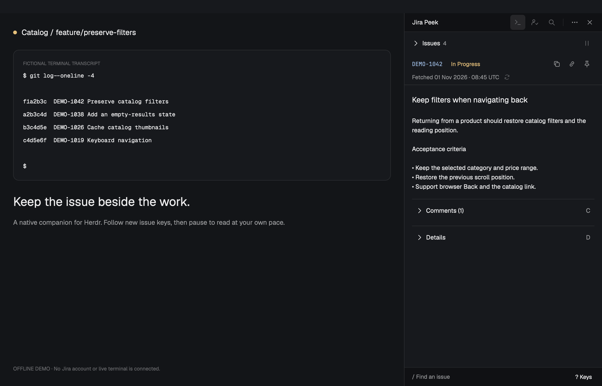

# Jira Peek for herdr-app

**Jira beside your agents.** A native panel for
[Herdr](https://github.com/herdrdev/herdr-app), the desktop terminal workspace.
It watches your focused terminal for Jira issue keys and shows the matching issue
beside it.

> **Unofficial community project, unaffiliated with Atlassian.** Not an Atlassian
> product or endorsed, sponsored, supported, or authorized by Atlassian.
>
> **AI-assisted, experimental software — use with caution.** Provided as-is, without warranty, under
> the [MIT License](LICENSE). Review the code and [limitations](#known-limitations),
> test in an isolated Herdr app home, back up settings, and grant only the Jira
> access you need. Read the [security policy](SECURITY.md) before connecting.

[Install](#install) · [Connect Jira](#connect-jira) · [Use it](#use-it) ·
[Documentation](#documentation)



More views: [Light mode](docs/screenshots/app-light.png) ·
[Compact browsing](docs/screenshots/app-short.png) ·
[Keyboard guide](docs/screenshots/app-help.png).

**Version 0.13.6 experimental.** Native desktop edition with a JavaScript/GPUI panel and a Rust runtime;
no browser frontend. Peek sends only read requests to Jira and never sends terminal input
or submits agent prompts. From terminal text, only validated allowlisted issue
keys are sent to Jira. The
[Peek for Jira TUI edition](https://github.com/hilmimuktitama/herdr-jira-peek) is a
separate project with independent releases.

## Install

Install [Herdr](https://github.com/herdrdev/herdr-app) first. Its components have
separate versions:

| Component | Requirement | Check |
| --- | --- | --- |
| **herdr-app**, desktop UI/mod host | **0.1.10 or newer** | `herdr-app --version` |
| **herdr-core**, terminal backend | `hc` on PATH; no numeric core minimum enforced | `hc --version` |

Keyboard entry through the host's pane navigation needs **herdr-app 0.1.12 or
newer**. Peek detects **0.1.16** host contracts at runtime for the native
checker, window activity, cancellable folder watches and bridge timeouts; older
hosts keep their previous behavior. The installation floor remains 0.1.10.

The Rust runtime, in-app setup and lifecycle commands need no Python, `jq`, curl
executable or external SHA utility. Git is required for release updates.
Existing TWG connections
instead require the official TWG CLI 1.2.6+ with OAuth. Release binaries target
macOS 15+ and glibc Linux (Ubuntu 22.04+) on arm64/x86_64; Linux needs system
libcurl with TLS support. Other Unix versions require a local build and validation.
Windows is unsupported;
the setup form supports Jira Cloud on `*.atlassian.net`, not Server/Data Center.

Download and extract the complete
[0.13.6 source ZIP](https://github.com/hilmimuktitama/herdr-app-jira-peek/archive/refs/tags/v0.13.6.zip),
or clone and check out `v0.13.6`. From the same
[release](https://github.com/hilmimuktitama/herdr-app-jira-peek/releases/tag/v0.13.6),
download your platform's executable, `.json` manifest and `-NOTICES.txt` file into
`.release-runtime` inside that extracted folder. Use the
[platform filenames](rust-backend/README.md#installation-and-distribution).
Launch Herdr once to create its app home and layouts, leave it running, then run
from the folder containing `package.json` (Apple Silicon example):

```sh
# Use the matching platform filename on other systems.
asset=jira-peek-bridge-macos-aarch64
chmod +x ".release-runtime/$asset"
".release-runtime/$asset" manage doctor
".release-runtime/$asset" manage install --source-root "$PWD" --check --attach
herdr-app do layout.switch '{"name":"main-jira-peek"}'
```

Doctor stays offline and does not check Jira credentials or fetch binaries.
Installation checks the matching assets' manifest, source identity, checksum and
startup behavior before replacing anything. Missing or incompatible assets leave
the previous installation intact. Download only trusted release assets; they are
not independently signed or notarized. No Rust toolchain is needed for a release.
For an unpublished checkout, build the package with
`python3 scripts/package-runtime.py`; developer requirements are in the
[runtime guide](rust-backend/README.md).

**Upgrading from 0.11.0 or earlier?** Your existing Python updater remains
supported for the transition. After upgrading, use the installed Rust commands.
See [maintenance](docs/MAINTENANCE.md#older-installations).

`--check` runs Herdr's native checker
before installation; it executes trusted mod code with your user-account access,
so it is not a sandbox or security audit. Install only source you trust.

`--attach` creates a personal `main-jira-peek` layout and `tabs-jira-peek` toolbar
with a **Jira Peek** toggle beside Files/Changes. It preserves shipped layouts
and shortcuts, and refuses conflicting personal edits. Select the printed layout
(or use Herdr's Layout menu).

Install from the complete source, rather than copying `mods/jira-peek` alone.
The default app home is `~/.config/herdr-app`. For a custom home or layout, use
`--app-home /absolute/path` and `--attach YOUR_LAYOUT` as described in the
[recipe](RECIPE.md#built-from); launch Herdr with the same `HERDR_APP_HOME` and
select the printed layout.

## Connect Jira

Choose **Set up Jira** in the panel, or **Options → Connection → Set up Jira**.
Have your site URL, account email, project keys, and API token ready.

1. Enter the Jira Cloud site root, such as `https://your-site.atlassian.net`,
   your email, and project keys (`ABC, DEF`). Omit `/jira` and `/browse` suffixes.
2. Use **Create API token ↗** to open Atlassian's token page, then paste the
   token into the masked field. Prefer a scoped token with only read permissions.
3. For a scoped token, enable **Scoped token** and enter your **Cloud ID**;
   see [Cloud ID instructions](https://support.atlassian.com/jira/kb/retrieve-my-atlassian-sites-cloud-id/)
   and [required token scopes](docs/CONNECTION.md#new-connection).
   Classic tokens skip this step.
4. Choose **Test & save**. On failure the previous connection stays intact;
   re-enter the token to retry.

Credentials are stored in private files under
`HERDR_APP_HOME/data/jira-peek/connection`, **not an encrypted keychain**. Other
processes running as your user and filesystem backups can access them. The
project allowlist limits keys sent; it does not grant or verify access to every
issue. See [connection and credential details](docs/CONNECTION.md).

**See your first issue.** Print a real issue key from a configured project in the
focused terminal, for example `echo ABC-123` with your own key. New terminal
sources start **Paused**, collecting keys without loading Jira details or metadata.
Click **Issues** and select the key, type it and press Enter, or resume Follow with
**F** to load it. If the key does not appear, check terminal focus and configured
project keys, then try **Options → Scan screen**. Short-lived keys can be missed.

**Already configured?** Choose **Choose configuration folder…**, or **Options →
Connection → Choose existing folder…**, and select the private folder containing
`config.sh`. No private configuration is copied. See
[existing TWG/REST configuration](docs/CONNECTION.md#existing-configuration).

## Show the panel

**×** hides Peek; the **Jira Peek** toolbar button reopens it, retaining selection,
filter, paused state, and width. If the button is missing, see
[toolbar repair](docs/MAINTENANCE.md#repair-the-toolbar) or
[manual integration](docs/PANEL-INTEGRATION.md#manual-integration).

## Use it

- **Start Paused.** New sources collect unread keys until you select an issue,
  edit the filter, or resume Follow. Returning to a terminal restores its session
  state. Auto-refresh is a separate opt-in. See
  [Follow and loading behavior](docs/FEATURE-DICTIONARY.md#jp-004--following-and-deliberate-reading).
- **Follow or browse.** Follow selects the latest visible confirmed key. Reading,
  selecting, filtering, or scrolling pauses it while new matches still collect.
  **F** resumes with the latest issue and clears the filter; **+new** reads one
  unread issue without resuming. **Keep this terminal** in Options keeps discovery
  on that terminal while you work elsewhere.
- **Resize the list.** Drag the centered grip at the bottom of the issue list
  up or down to resize it smoothly, up to four rows. The size stays for this
  panel session. Fewer filtered matches shrink it temporarily; clearing the
  filter restores your size.
- **Find and read.** Click **Issues**, type to filter loaded metadata, then press
  Enter to read. You can also enter an allowlisted key or same-site Jira browse
  URL. Click the issue key to open Jira; expand **Details** or **Comments** for
  more content. Progress appears immediately left of Refresh, replacing the
  timestamp while busy; the last fetch time remains in its tooltip and returns
  afterward.
- **Copy or pin.** **Y / Shift+Y** copies the key/link. Drag over reader text and
  use **Cmd+C / Ctrl+C** to copy a selection. **Options → Copy issue as Markdown**
  copies the loaded issue without fetching more data. **P** toggles a pin;
  **K** returns to it without clearing your filter. The inline pin targets the
  viewed issue; unavailable actions show a note. Click a pinned row’s accent
  pin to unpin without selecting it.
- **Arrange fields.** **Options → Fields** lets you order, label, show, or hide
  fields in Header, Body, or Details. **Apply** saves a layout per connection;
  Back/Escape discards the draft. It changes Peek's presentation, not Jira.
  Choose **Add Linked Issues** for grouped relationships, clickable Jira keys
  and embedded summary/status. Its disclosure uses the same chevrons as
  Details/Comments; expand five/all loaded links without another request.
  Agents configure the same `issuelinks` field with Body, Details or Hidden placement.
  See the [field configuration guide](docs/AGENT-GUIDE.md#shared-reader-configuration).
- **Start fresh.** **Options → Clear list**, or **Clear list** in the header
  `...` menu, resets collected keys, filter, unread state, and pin for this
  terminal while preserving Follow/Paused and caches.
  Continuously visible keys stay suppressed after a fresh screen baseline;
  deliberate lookup or scans can restore them. See
  [Clear list details](docs/FEATURE-DICTIONARY.md#jp-007--clear-list).

Auto-refresh is off by default. When enabled, it refreshes at most once a minute
and pauses the idle panel after five minutes; resume through Options. Hiding
Peek does not end an active refresh lease. The timestamp is fetch time, including
cache hits, rather than proof of current Jira state. See
[refresh behavior](docs/FEATURE-DICTIONARY.md#jp-029--auto-refresh-issue-and-local-idle-pause).

Click **Issues** before typing on hosts older than **herdr-app 0.1.12**. On
0.1.12 or newer, the host's pane navigation can land on Peek and hand it the
keyboard. **Cmd+F (macOS)** returns to the filter while Peek owns the keyboard;
**Tab / Shift+Tab** moves between controls. Letter shortcuts are ignored while
typing, and `/` is literal in the filter.

| Key | Action |
| --- | --- |
| **↑ / ↓**, **Enter** | Choose an issue, then read inside Peek |
| **Escape** | Back through disclosures and Issues, then return to the terminal; on 0.1.12+ moves focus left when the origin is gone |
| `/` | Find another issue from the reader/list |
| **F**, **P**, **K** | Toggle Follow, toggle pin, return to pin |
| **Y / Shift+Y** | Copy key / copy link |
| **Cmd+Enter / Ctrl+Enter** | Open Jira from the reader/list, outside text fields |

**? Keys → More shortcuts** has the full guide. Optional [key bindings](keys.json)
are examples; installation does not modify your shortcuts.

## Known limitations

- Offline native checks ran on macOS arm64 with stock **herdr-app 0.1.15** and
  **herdr-core 0.1.19**. Linux GUI and complete screen-reader use remain unverified.
- Linked Issues uses the same native Button disclosure pattern as Details/Comments.
  Its accessible name states expanded/collapsed. Stock herdr-app 0.1.15's script
  Accordion binding drops labels/focus, so no separate expanded-state attribute
  is exposed. Full screen-reader use remains unverified.
- Keyboard-only entry needs **herdr-app 0.1.12 or newer** and the host's pane
  navigation; on older hosts click Issues first. The 0.1.16 checker/window/watch
  refinements and the Escape fallback still need a live native check; unit tests
  do not prove native keyboard behavior. Wheel/trackpad scrolling may still be
  needed for long content, and hiding Peek may reset reading position. Peek ships
  no patched host.
- Polling can miss transient keys or collect a stable fragment. Missing metadata
  does not prove an issue is absent. Rich content is bounded plain text; images,
  active body links, and some content are omitted. Open Jira for complete content
  and current permissions.
- Text selection is pointer-driven and **Cmd+A / Ctrl+A** selects one text block.
  Cross-field, keyboard caret, and screen-reader selection are not promised. The
  host trims outer whitespace on selection copy. Whole-block copying passed
  isolated native checks; partial-drag copying remains inconclusive. Check the
  pasted content, or use **Copy issue as Markdown**. See
  [selection details](docs/FEATURE-DICTIONARY.md#jp-042--selectable-reader-text).
- Clipboard copies can expose private issue content and persist in history or
  OS sync. Markdown copy includes configured Details even when collapsed and
  loaded comments; Hidden fields are excluded, with no additional redaction.
  Treat copied text as data, never shell commands, and review before pasting into
  a renderer or agent. See [clipboard limits](docs/FEATURE-DICTIONARY.md#jp-041--copy-issue-as-markdown)
  and [security and cleanup rules](SECURITY.md).
- Hiding retains panel memory; removing it or quitting discards that memory.
  Credentials, disk caches, clipboard, and backups have separate lifetimes.
  Peek targets stock herdr-app and ships no patched host; historical source
  highlighting and native input patches are retired.

## Update and maintenance

Run the installed `runtime/jira-peek-bridge manage update --check` to report
availability, then omit `--check` to update. See the
[complete command](docs/MAINTENANCE.md#update). Updates select numbered release
tags, including GitHub prereleases, and require Git. They preserve private
settings and refuse edited managed files. No background updater is installed;
a prepared layout must be selected manually.
Tag checks do not verify release signatures or protect against a compromised
repository or toolchain. See [maintenance](docs/MAINTENANCE.md) for rollback,
repair, cache clearing, preview migration, and uninstall.

## Documentation

| Task | Guide |
| --- | --- |
| Token scopes, credential storage, existing TWG/REST setup | [Connection](docs/CONNECTION.md) |
| Update, rollback, repair, clear cache, uninstall | [Maintenance](docs/MAINTENANCE.md) |
| Custom layouts and manual toolbar attachment | [Panel integration](docs/PANEL-INTEGRATION.md) |
| Agent settings, field schema, and native commands | [Agent guide](docs/AGENT-GUIDE.md) |
| Detailed behavior and state lifetimes | [Feature dictionary](docs/FEATURE-DICTIONARY.md) |
| Rust runtime and local benchmarks | [Runtime guide](rust-backend/README.md), [benchmark harness](benchmarks/README.md) |
| Development and release checks | [Recipe](RECIPE.md), [releasing](RELEASING.md#candidate-checks) |

General contributions and bug reports are closed for now; private vulnerability
reports are the exception. No support, fixes, or release schedule are promised.
See [contribution policy](CONTRIBUTING.md) and [security reporting](SECURITY.md#reporting-a-vulnerability).
Use the [isolated fictional fixtures](docs/screenshots/README.md) for shared screenshots.

By [hilmimuktitama](https://github.com/hilmimuktitama), adapted from the earlier
[Peek for Jira project](https://github.com/hilmimuktitama/herdr-jira-peek).
Distributed under the [MIT License](LICENSE); see
[third-party notices](THIRD_PARTY_NOTICES.md). Jira and Atlassian are Atlassian
trademarks.


## Read-only workspace

The header source icons are **Terminal** (prompt), **My work** (person with check),
and **Search Jira** (magnifier). Hover or keyboard focus reveals the name; the
selected source stays highlighted and exposes its pressed state. Tab moves among
controls and Enter/Space selects a source. Selecting the active icon again does
not refresh, reset, or go Back. The icons stay beside the title at every panel
width; the title truncates when space is tight.

All sources share Terminal's toolbar, input, list and reader positions. **Issues**
is the visible list/reader disclosure for every source. Its right-hand action is
Follow for Terminal, **Refresh My work** for My work, and **Search Jira** for Search.
In a Search reader, that action opens the query field without submitting it.
Terminal and My work use **Filter issues** locally. Search replaces that field
with **Search Jira…**: Enter or the toolbar magnifier submits words or an issue
key to Jira. Search has no second local filter or input mode switch. Typing and
clearing its draft leave submitted results intact until another explicit search.

Collection status, **Cancel**, **Retry** and **Load more** occupy the existing
bottom strip, so loading and pagination do not move the toolbar or reader. Hover the status for
connection/project scope, full status and collection fetch time. The issue's own
fetch time and Refresh remain beside the reader. Load more appears only in the
list while another page is available; it uses the submitted query, not the draft.

Refreshing My work keeps an open reader while loading and after success if its
issue remains in the refreshed page. Failure or cancellation retains that reader;
if the issue is absent from the refreshed page, the list returns without selecting
another issue. Focus returns to the list only if the removed reader still owns it;
a deliberate focus move is preserved. Issue details keep their own fetch time.
A recoverable My work refresh failure shows **May be stale** and **Retry** in the
footer when results are retained. Retry requests a fresh collection page while
preserving the reader and local filter; it returns focus to the reader or list.
Failed pagination keeps **Load more**. Ready status names **My work** beside the
loaded count; Search keeps its submitted-query status.

Empty states distinguish a new search, searching, no matches for the submitted
query, and an empty page with more pages available. Errors use short footer text;
the full reason, retry guidance and scope remain in its tooltip and accessible
name. Retained results are marked as potentially stale after a failed refresh.

Source switching keeps focus on the activated icon and restores the source's
reader/list view, selection, loaded pages, local filter (Terminal/My work) and
unsubmitted Search draft. **Issues**, Cmd+F, `/` outside inputs and the `search`
command focus the visible field. Opening Issues selects its retained text;
Search Enter always submits, while Up/Down moves from its field to the results
for navigation and Enter to read. Escape in the Search field cancels pending
collection work and focuses results without changing source or draft. Escape in
a remote reader returns to results after closing its active disclosures.
Auxiliary screens keep their own Back/Escape behavior.

Terminal remains the initial source, with its collected keys, local filter,
Follow, unread state and terminal pins. **My work** deliberately loads unresolved
issues assigned to you in the configured projects. Reopening it retains the
session results; Refresh My work requests a new page. **Search** accepts a literal
text phrase or an allowlisted uppercase issue key. Use its Search button or press
Enter in the search field. Typing alone does not fetch, and raw JQL is not accepted.
My work filtering stays local; Enter there opens a loaded result.

Both remote sources show the connection and project scope. Pages contain at most
50 metadata rows; Load more appends unique keys in stable order, up to 200 retained
rows. “Loaded” and “partial” describe this bounded list, not a Jira total. Details
load through the existing reader. Returning to the list retains the
selection and query and focuses the results. Each source retains its native list
scroll handle; the stock host has no readable pixel-offset API, so exact scroll
restoration across unmounts is not guaranteed. Terminal-only actions remain unavailable
in remote sources. Existing `search` focuses the visible filter or Search field;
`back` additionally returns a remote reader to results.

Cancel and source/query changes retire pending results. Requests retain their
occupied slots until completion; selected details have priority within the shared
two-slot budget. Collection failures do not revoke unrelated issue access.
Refresh failures retain loaded results with a stale message. Authentication loss
clears connection state. Rate limiting reports a retry time and blocks collection
submission until that time, including queued work after source switching or
Cancel. Late rate limits from an older connection are ignored. There is no
automatic collection retry or polling.

Discovery requires the REST backend. TWG and the legacy shell bridge retain their
existing issue-reading capability; they do not gain a search transport or silently
switch backends. Explicit search text and generated scoped queries go to Jira only
on deliberate submission/entry. Terminal content never becomes a remote query.
Collection pages are session memory only, with no persistent search cache.
Collection Refresh updates row titles/statuses and local filtering independently
of retained reader bodies. A late issue denial still retires that issue across
retained sources within the same connection; stale connection results are ignored.

Configure source shortcuts in Herdr’s personal `keys.json` using the optional
[bindings example](keys.json): **Alt+1** → Terminal, **Alt+2** → My work,
**Alt+3** → Search Jira, scoped to `mod:jira-peek`. Replace those chords to suit
your preferences. Installation does not overwrite personal shortcuts. These
commands select a source while Peek owns focus; they do not open a hidden panel.
They preserve drafts and views, and leave auxiliary screens untouched. Existing
`jira-peek.search` continues to focus the local results filter.

Options, Fields and Connection use a consistent header Back arrow with a named
destination on hover/focus. Fields keeps Apply in the header; Back/Escape discards
the draft. Connection returns to the screen that opened it.
