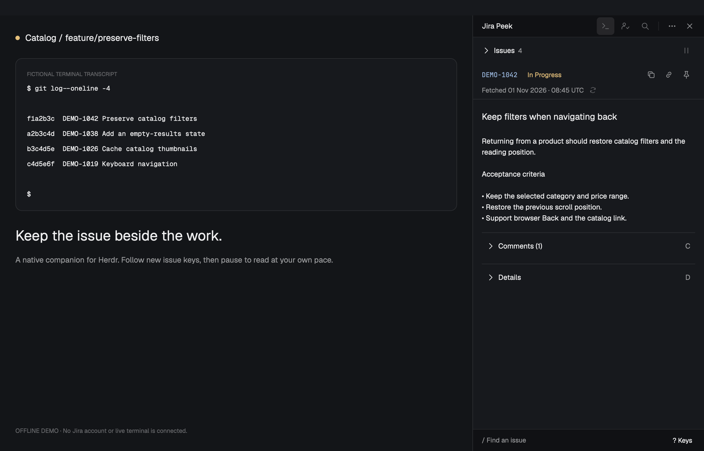

# Jira Peek

A native Jira reader beside the terminal you are working in. Issue keys arrive
automatically; deliberate reading stays put. Colors and typography follow Herdr.



**Experimental 0.13.6. AI-assisted — use with caution.** Developed with AI
assistance and provided as-is under the [MIT License](LICENSE), without warranty.
Collaboration, pull requests, issue reports, feature requests and support are
closed for now. See the [project policy](CONTRIBUTING.md) and [security policy](SECURITY.md).

## What you see

A right panel with Issues, an icon button for Following/Paused, a More actions menu
(Clear list and Options) and a close control. The
current issue's key, status, title, fetch time and actions lead the reader.
Descriptions are directly readable; Details and Comments reveal more content.
Open in Jira, copy and refresh remain accessible above the scrolling body.
The heading, actions, reading text and disclosure labels share an aligned gutter.
Compact spacing groups issue identity and metadata; straight separators organize
disclosures. Comments, Details and Linked Issues keep their labels and expanded
content on that gutter, with the state chevron trailing and any shortcut hint
before it. They keep balanced space around their controls, including when placed
inside Details. Expanded entries avoid extra trailing gaps.
Titles lead the reading hierarchy. The metadata/reader divider has balanced
insets, and the title and description share the reader's section spacing.
Smaller metadata keeps controls quiet. The fetched date and UTC time stay visible
beside Refresh; when the full `Fetched …` stamp does not fit, it shortens to the
date and time on one line at the 300-pixel panel floor, while the full stamp
remains in its tooltip, accessible name and copied Markdown. Details repeats the
visible stamp at secondary size and keeps the full form in its accessible name. No blank reserved line pushes the
title down. Rows grow with Herdr's UI font.
Reading surfaces keep a full accent outline while focused and a quiet boundary
otherwise. Help uses its empty footer space while preserving the hidden reader's
viewport and reading position; focused icon captions still have their own strip.

Issues is one expandable disclosure with a focused filter and stable list.
The header More actions menu, anchored to its ellipsis, holds Clear list (eraser
icon) and Options, so the filter and a large +N new badge keep their full width;
the filter's own × clears only the query. Filtering previews the matching selection or the first match
without another action. Enter collapses results for full reading; reopening
keeps the query and browsing order. Every matching ticket keeps its row and a
visible highlight marks the selection. Up/Down moves the highlight without
reordering results;
scrolling reveals the selected row only when it leaves the viewport.
The selected result keeps its key, status and copy/pin actions on one row,
with no selection checkmark or repeated identity below the list. Collapsed
reading keeps one identity/action row above the body.
Long statuses truncate with a tooltip; the fetched timestamp and Refresh stay underneath.
Filtered results use individually sized keys, full-width titles and quiet
row dividers. Status follows each key with a consistent gap; long keys do not
widen other rows. The key's hover button fits its text inside its bounded slot.
Long keys truncate with their full identity in the Open tooltip.
Rows stay top-aligned and keep the same key clipping when selection changes.
Balanced vertical padding separates tickets without shrinking the
32px action targets. Rows and the filter grow with host typography; the viewport
defaults to complete rows. Drag its bottom border to resize smoothly up to four
rows, without snapping during drag or release. The choice lasts for the panel
session. Short panels scroll together when needed. This follows the compact
spacing and semantic grouping in
[Atlassian's spacing guidance](https://atlassian.design/foundations/spacing) and
the distinct action targets in [Carbon's table guidance](https://carbondesignsystem.com/components/data-table/usage/).
Its complete default title leads the scrolling reader at every height.
Custom layouts stay intact. While Paused, newly captured or newly matching
issues join the bottom automatically. The existing row order and list height
stay stable during arrivals; selection and scroll stay put. Live metadata
filtering and the 200-issue limit may remove rows. The key opens Jira without a logo.
Copy key, Copy link and Pin appear as one group on the hovered row; its actions
work without selecting it first. The pinned row keeps its accent pin visible
and keyboard-focused controls stay visible. Loading/queued progress and
“Refreshing the issue…” sit immediately left of Refresh. While busy, its tooltip retains the last fetch time; the visible timestamp
returns afterward. Failure feedback and Retry remain separate.
Enabled buttons, clickable keys and available result rows and titles use a pointing-hand cursor.
Copy feedback and shortcuts remain available.
The Follow icon shows the next action: pause while Following, play while Paused.
Its short tooltip names the action and shortcut; pausing keeps the selection
while new issues collect, and resuming selects the latest issue and clears the
filter. Control tooltips stay brief; Help holds detailed instructions. Tooltips
for clipped values, source identity and fetch time retain their content. There is no visible
match counter; the selected position remains in its accessible name.
New unread activity sits beside navigation without moving the issue actions.
Options and Help use a header Back arrow to
return to Issues. Fields and Connection use the same header placement; form Help
preserves drafts. Empty fields stay hidden by default.
Long titles scroll with the body while key/actions stay above it.
Short panels budget a smaller list beside a readable preview; extremely short
panels scroll the content together rather than hiding the selected ticket.
The footer shows the current reading/search keys and keeps **? Keys** within
reach. Clear list is available from the header `...` More actions menu; it
matches Options' action, stays separate from the filter's ×, and keeps the
filter and a large `+N new` badge at full width. A
pinned Return label keeps its keycap and full name. The guide leads with the daily
Find → Read → Back loop; other actions
live under More shortcuts. Enter reads inside Peek; Cmd+Enter or Ctrl+Enter
explicitly opens Jira from nonediting issue contexts. Native buttons retain
Enter/Space activation. Comments and Details show their keys; C/D focus those
disclosures, F toggles Follow, and N reads
one unread issue. Keyboard reading pauses Follow without losing the query.
P or the inline pin keeps one issue for this terminal; P again unpins it.
Pinning a different issue moves the pin immediately. During a detour, the existing
footer offers Return to KEY; K returns without clearing the filter. There is no
management screen or added row. Copy key/link, Copy issue as Markdown, Open and
Refresh target the viewed issue; the Markdown copy is built only from loaded
fields and comments, with Hidden fields excluded.

## How it behaves

Use the [product dictionary](docs/FEATURE-DICTIONARY.md) to identify feature
contracts and coupled checks before adapting behavior.
Use the [reliability guide](docs/RELIABILITY.md) for stack references,
failure injection, native acceptance checks and unresolved reliability gaps.

- Read explicitly addressed terminal screens with `hc read --lines 0`.
  Read history only when requested, up to 200 available lines. Do not send
  terminal input, scroll the terminal, or move focus during discovery.
- Start each new source Paused, collecting unread keys without Jira issue or
  metadata reads. Selection, deliberate filter edits or resuming Follow activates
  loading for that source for the session. Keep activation across Clear list and
  source return; reset it on reconnect or eviction. After activation, retain
  normal Paused metadata collection. Follow the latest visible allowlisted key.
  User reading/filtering/selection pauses Follow. Append new matches to the browsing order automatically,
  keeping selection, filter and list height during incoming discovery. Canonical
  recency stays separate for Follow, requests and retention. Query edits rebuild
  matches; acknowledge one issue when reading the unread badge.
- Confirm new screen keys in two observations at least 250ms apart, with one
  bounded extra read per scan. History and direct lookup are deliberate and
  immediate. Distinguish missing, loading and unavailable titles without
  treating a missing metadata row as proof that an issue does not exist.
- Clear list resets only the current terminal's collected issues, query, unread
  keys and issue pin. Preserve Follow/Paused, other sources and caches. Establish
  a fresh complete screen baseline, suppress its continuously visible keys,
  and reject pre-clear results without freeing occupied request slots early.
  The header More actions menu exposes the same one-click Clear list directly;
  both entry points share its availability, outcome and focus.
- Keep this terminal retains one exact source; the panel shows Keeping this
  terminal while it is enabled. Keep machine-qualified addresses distinct;
  Jira authentication and requests remain local even for remote terminals.
- Issue pins retain one key per source within the existing 200-key/12-source
  bounds, without retaining an extra body. They are session-only and reset with
  connection/cache state. Pinning is a direct, reversible action on the currently
  viewed issue. Never pin an issue for a manual source or infer a task.
- Search loaded metadata or look up an allowed key/same-origin Jira browse URL.
  Reject foreign origins and disallowed projects. Preview matching results
  when the filter changes or results are updated, keeping unknown lookups
  explicit through Enter. Unmatched queries show No matches, including valid
  issue keys, without a separate lookup prompt. Hidden filtered selections
  cannot own browsing actions or requests.
  Deliberate unread/pin/direct reader entry remains actionable outside the
  saved filter; reopening results invalidates that reader entry until chosen again.
- Request issue details on selection, reuse valid caches, and keep at most two
  issue/metadata reads in flight. Prioritize the latest selection and preserve
  loaded content on refresh failure. Protect newer searchable rows independently
  of detail-body eviction. With REST, load comments separately.
- Default auto-refresh off. When enabled, refresh at most once per minute,
  pause only the idle panel after five minutes, preserve the shared saved choice,
  and show actual fetch time. Resume is local; turning it Off is shared.
- Share field layouts and reader preferences through the versioned
  `data/jira-peek/fields.json`. Validate edits, preserve last valid state, reject
  stale UI writes, and keep this file outside managed source. Use the
  [installed agent contract](docs/AGENT-GUIDE.md) and
  [schema](mods/jira-peek/fields.schema.json).
- Hide/reopen through a persistent personal toolbar toggle. On stock hosts,
  click Issues to enter Peek; Cmd+F and Tab work once it owns keyboard focus.
  Reliable terminal-to-panel keyboard entry remains unshipped. Retain native
  text editing and focus behavior.

## Built from

**herdr-app >= 0.1.10** is the desktop UI/mod host. **herdr-core** is the separate
terminal backend exposed as `hc`; the installer requires it on PATH without a
numeric core minimum. Check `herdr-app --version` and `hc --version` separately.
Keep **0.1.10** exact; never substitute **1.10.0** or a core/TUI version.

Use the complete 0.13.6 source distribution and its three matching platform
assets as described in [installation](README.md#install). Rust owns doctor,
install, update, rollback, toolbar diagnosis/repair, setup and standalone cache
clearing. The supported JavaScript/GPUI panel remains. From the source root,
using the Apple Silicon asset as an example:

```sh
asset=jira-peek-bridge-macos-aarch64
chmod +x ".release-runtime/$asset"
".release-runtime/$asset" manage doctor
".release-runtime/$asset" manage install --source-root "$PWD" --check --attach
herdr-app do layout.switch '{"name":"main-jira-peek"}'
```

`--attach` creates a personal layout and Jira Peek toolbar toggle, preserves
originals and shortcuts, and refuses conflicts. Use `--attach YOUR_LAYOUT` for
a different layout using stock tabs or a compatible personal toolbar clone.
Use `runtime/jira-peek-bridge manage integration diagnose` from the installed mod
directory to inspect the active layout, then
`runtime/jira-peek-bridge manage integration repair --layout YOUR_LAYOUT` to
prepare its personal copy.
Repair preserves custom controls and reuses an existing Peek panel ID; select
the printed layout explicitly. Unsupported structures receive manual guidance.
Later installs use `--update --check`; the
[update guide](docs/MAINTENANCE.md#update) explains private-preview
0.1.0 migration, numbered releases and rollback. Updates protect edited files
and retain the complete prior bundle. No personal layouts ship in this repository.

Use native GPUI controls, theme colors, argument-array execution and bounded
state. `demo.js` supplies wholly fictional content only when `props.demo` is
true; live operation must never silently fall back to the demo. Installed
`AGENTS.md` documents settings and native commands.

`model.js` owns issue-state transitions, projection ordering and retention;
`main.js` owns native interaction and asynchronous scheduling. The panel invokes
the Rust executable for configuration, connection epochs, cached Jira reads and
private setup transactions. Field editing uses host file APIs. The source shell
bridge and Python setup helper remain compatibility oracles. Cache misses
reserve ordered attempts before transport, preventing older completions from
publishing over newer attempts. Publication locks recover old empty directories
after a grace period. Installation replacement journals the exact backup so a
later mutating invocation can recover a missing active bundle after interruption.
Rust batch and detail projections preserve the shell oracle's privacy rules and
picker bounds. The oracle shares `fields.jq`; keep those helpers in one module
because nested calls between projection modules abort in jq 1.8.2. Reader rich
text has separate bounds.

Do not rebuild the host during ordinary installation. Jira Peek targets stock
hosts and ships no patched host; the historical input and highlighting
extensions are retired. Stock-host input, scrolling and accessibility limits
remain documented. The optional [keys.json](keys.json) has only
mod-scoped F2/F5 and Alt+1/2/3 bindings; merge individual entries without replacing existing
keys.
See [toolbar integration](docs/PANEL-INTEGRATION.md) for custom layouts.

## Runtime performance experiments

Passive scans process every observation, including identical text needed for the
250ms settling rule. They notify the native host only for changed presentation;
request loading/completion and settled Scan availability still notify. An
in-flight read is not a visible change and must not repaint Options. Preserve
the 100ms row-action/focus recovery timer (JP-001, JP-007–009, JP-014, JP-026–029).
Use the [isolated idle benchmark](docs/screenshots/README.md#idle-redraw-benchmark)
for local CPU, panel-render and host window-render comparisons. These counters
do not measure physical display presentations.

The [Rust runtime](rust-backend/README.md) keeps the JavaScript/GPUI panel and
uses one executable per operation. It covers config/stamp/clear, issues,
metadata and comments, with REST in process and TWG through its existing CLI.
The installer stages a checked production binary and notices with the mod;
the legacy `runtime/app-bridge.sh` entry point forwards to it. Configuration,
connection namespaces and cache formats stay compatible. `scripts/app-bridge.sh`
remains the regression/benchmark oracle. Build local assets before development
installation with `python3 scripts/package-runtime.py`; fixture-enabled builds
are never installable production assets. Preserve JP-022–039 during migration.
The [bridge harness](benchmarks/README.md) uses actual curl and in-process libcurl
against identical local HTTPS fixtures and checks median/p95 targets. No daemon
is needed for the measured process-per-call latency.

## Watch out

Review the code and [known limitations](README.md#known-limitations), test in an
isolated app home, back up settings and grant only necessary Jira access.
No support, fixes or release schedule are promised.

This mod runs local programs and reads terminal content. It makes read-only
Jira requests but an account/token may have broader permissions. Credentials
and issue caches use private local files, not an encrypted keychain. Read
[SECURITY.md](SECURITY.md) for permissions, retention and cleanup limits.

Never render issue bodies as active HTML/Markdown or send their text through a
shell. Mark unsupported/shortened content. Preserve connection/source boundaries
and reject stale responses. Hiding a panel does not close its in-memory state.
Stock-host input gaps, Linux GUI and accessibility limits remain documented.

## Done when

- The assembled mod passes Herdr's native checker and renders in an isolated app.
- Following, Browse, filtering, pinning and unread navigation preserve their
  documented state through asynchronous discovery and failures.
- Setup, fields and Help retain drafts and give errors without exposing secrets.
- Reader actions remain named and available at narrow widths, with hover and
  keyboard focus revealing browsing controls; text remains readable.
- The installer preserves private configuration, layouts, shortcuts and local edits.
- No optional host build is required; stock-host limitations are checked
  separately.
- Shared captures use only the [fictional fixtures](docs/screenshots/README.md).


## Read-only workspace

The header source icons are **Terminal** (prompt), **My work** (person with check),
and **Search Jira** (magnifier). Hover or keyboard focus reveals the name; the
selected source stays highlighted and exposes its pressed state. Tab moves among
controls and Enter/Space selects a source. Selecting the active icon again does
not refresh, reset, or go Back. The icons stay beside the title at every panel
width; the title truncates when space is tight.

All sources share Terminal's toolbar, input, list and reader positions. **Issues**
is the visible list/reader disclosure for every source. Its right-hand action is
Follow for Terminal, **Refresh My work** for My work, and **Search Jira** for Search.
In a Search reader, that action opens the query field without submitting it.
Terminal and My work use **Filter issues** locally. Search replaces that field
with **Search Jira…**: Enter or the toolbar magnifier submits words or an issue
key to Jira. Search has no second local filter or input mode switch. Typing and
clearing its draft leave submitted results intact until another explicit search.

Collection status, **Cancel**, **Retry** and **Load more** occupy the existing
bottom strip, so loading and pagination do not move the toolbar or reader. Hover the status for
connection/project scope, full status and collection fetch time. The issue's own
fetch time and Refresh remain beside the reader. Load more appears only in the
list while another page is available; it uses the submitted query, not the draft.

Refreshing My work keeps an open reader while loading and after success if its
issue remains in the refreshed page. Failure or cancellation retains that reader;
if the issue is absent from the refreshed page, the list returns without selecting
another issue. Focus returns to the list only if the removed reader still owns it;
a deliberate focus move is preserved. Issue details keep their own fetch time.
A recoverable My work refresh failure shows **May be stale** and **Retry** in the
footer when results are retained. Retry requests a fresh collection page while
preserving the reader and local filter; it returns focus to the reader or list.
Failed pagination keeps **Load more**. Ready status names **My work** beside the
loaded count; Search keeps its submitted-query status.

Empty states distinguish a new search, searching, no matches for the submitted
query, and an empty page with more pages available. Errors use short footer text;
the full reason, retry guidance and scope remain in its tooltip and accessible
name. Retained results are marked as potentially stale after a failed refresh.

Source switching keeps focus on the activated icon and restores the source's
reader/list view, selection, loaded pages, local filter (Terminal/My work) and
unsubmitted Search draft. **Issues**, Cmd+F, `/` outside inputs and the `search`
command focus the visible field. Opening Issues selects its retained text;
Search Enter always submits, while Up/Down moves from its field to the results
for navigation and Enter to read. Escape in the Search field cancels pending
collection work and focuses results without changing source or draft. Escape in
a remote reader returns to results after closing its active disclosures.
Auxiliary screens keep their own Back/Escape behavior.

Terminal remains the initial source, with its collected keys, local filter,
Follow, unread state and terminal pins. **My work** deliberately loads unresolved
issues assigned to you in the configured projects. Reopening it retains the
session results; Refresh My work requests a new page. **Search** accepts a literal
text phrase or an allowlisted uppercase issue key. Use its Search button or press
Enter in the search field. Typing alone does not fetch, and raw JQL is not accepted.
My work filtering stays local; Enter there opens a loaded result.

Both remote sources show the connection and project scope. Pages contain at most
50 metadata rows; Load more appends unique keys in stable order, up to 200 retained
rows. “Loaded” and “partial” describe this bounded list, not a Jira total. Details
load through the existing reader. Returning to the list retains the
selection and query and focuses the results. Each source retains its native list
scroll handle; the stock host has no readable pixel-offset API, so exact scroll
restoration across unmounts is not guaranteed. Terminal-only actions remain unavailable
in remote sources. Existing `search` focuses the visible filter or Search field;
`back` additionally returns a remote reader to results.

Cancel and source/query changes retire pending results. Requests retain their
occupied slots until completion; selected details have priority within the shared
two-slot budget. Collection failures do not revoke unrelated issue access.
Refresh failures retain loaded results with a stale message. Authentication loss
clears connection state. Rate limiting reports a retry time and blocks collection
submission until that time, including queued work after source switching or
Cancel. Late rate limits from an older connection are ignored. There is no
automatic collection retry or polling.

Discovery requires the REST backend. TWG and the legacy shell bridge retain their
existing issue-reading capability; they do not gain a search transport or silently
switch backends. Explicit search text and generated scoped queries go to Jira only
on deliberate submission/entry. Terminal content never becomes a remote query.
Collection pages are session memory only, with no persistent search cache.
Collection Refresh updates row titles/statuses and local filtering independently
of retained reader bodies. A late issue denial still retires that issue across
retained sources within the same connection; stale connection results are ignored.
