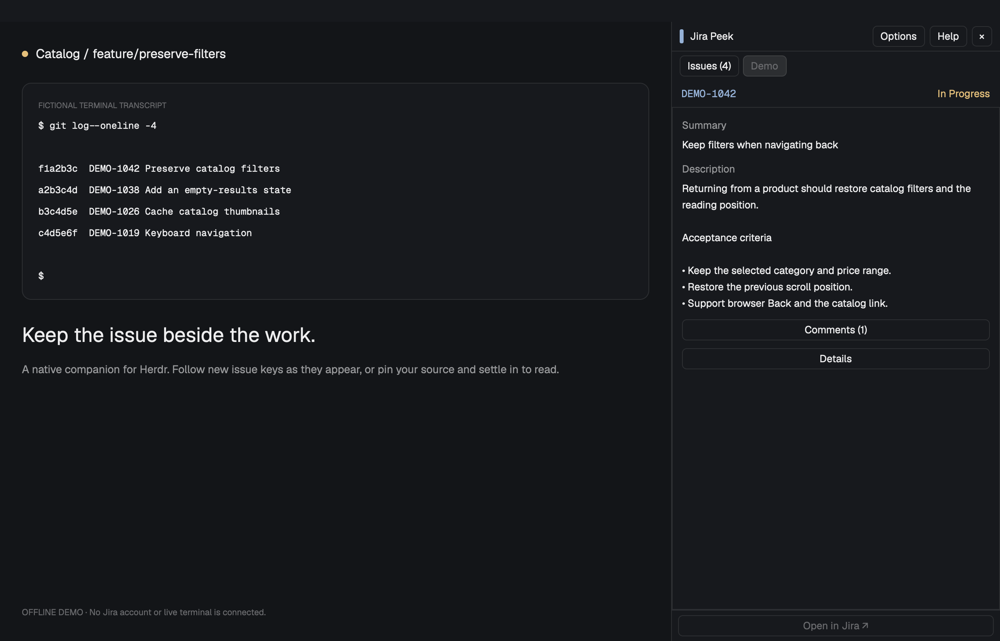

# Jira Peek

A quiet Jira reader beside the terminal you are working in. New issue keys
arrive automatically; deliberate reading stays put. Its colors follow Herdr's
current theme and font-size settings.



**Experimental 0.1.0 — private preview.**

## What you see

A right panel with Issues, Following/Paused, and Options.
Help in the header opens brief guidance for the current screen in the same panel.
The terminal's session title appears only in source tooltips, never as a visible row.
Pinned source appears as a brief indicator when focus no longer chooses the source.
The default layout puts the current issue first: key and status stay above the scrolling reader,
followed by a semibold title and the complete loaded description. All panel text
uses Herdr's `ui_font_size`; the host applies zoom. Long descriptions
use the reader's normal scroll region.
Details reveals the exact fetch timestamp and
configured metadata; Comments expands separately. Compact values retain text-preview
tooltips, and partial comments are identified when opened. With the REST
backend, core issue data loads before optional comments; opening Comments
fetches a bounded page independently, and its failure keeps the description
readable with a local retry. Unsupported document content is identified rather
than silently omitted. Open in Jira is the
persistent primary action.

Issues reveals search and the discovered list. Options contains pinning,
refresh, copy, Highlight source, screen/history reads, Auto-refresh issue, Fields, connection settings, and
cache clearing. Its rows scroll at short heights. Status feedback appears
when needed; there is no permanent operation footer. Theme tokens govern colors.

## How it behaves

**Options → Fields** saves one reader layout per configuration folder and Jira
site. Place fields in Header, Body, Details, or Hidden; rename labels; reorder
within each section; add standard/custom Jira IDs; and optionally show empty
values. Apply rebuilds the reader; Back/Escape discards the draft. Reset restores
the configured field defaults in the draft. The issue key and Open in Jira stay
available. Comments support Body, Details, or Hidden. The limit is 32 fields;
there are no project/type variants or field-catalog discovery.

The UI and agents share `${HERDR_APP_HOME}/data/jira-peek/fields.json`.
The installed `mods/jira-peek/AGENTS.md` documents the versioned format;
`fields.schema.json` supplies editor validation. Copy config path in Fields
reveals the exact path. The root `preferences` object stores the shared
`autoRefresh` and `highlightSource` booleans, using the same values as Options.
Watch the file for edits; reject invalid documents
without replacing the working layout. Save UI edits with the native file API's
expected-text guard, retaining the draft if another writer changed the file.
Migrate prior per-connection UI preferences on connection. Keep the file outside
the managed bundle so updates preserve it. The demo uses separate preferences.
See [the agent contract](docs/AGENT-GUIDE.md) and
[researched workflow ideas](docs/AGENT-WORKFLOWS.md).

The installed guide also maps connection/data settings, host typography,
placement, width, keys, and session actions. Expose existing actions through
`nextCommand` so agents can use the native `herdr-app do jira-peek.<command>`
route. Pause/resume and pin/unpin set explicit states; reader actions cannot
interrupt a settings draft. Commands reach shown copies, so their dispatch
acknowledgment is not proof that a particular Jira request completed.

The header × hides the attached panel. A persistent Jira Peek toggle in a
[personal tabs mod](docs/PANEL-INTEGRATION.md) reopens it beside Files/Changes.
With that toolbar's keyboard handler and the optional binding, Ctrl+Shift+J
reveals Peek and focuses search. Type to replace the selected previous filter,
use arrows to preview, and Enter to read. Typing while connecting is retained.
The same shortcut returns to the originating terminal with the filter intact.
Native hiding preserves width, filter, selection and Paused state. Herdr 0.1.11
resets the reader's scroll position on reopening.
Escape returns to the terminal after choosing an issue. A pinned issue source
does not change that return target. Open forms keep their draft. No focus
changes happen on startup or refresh, and no terminal input is sent.

With the reader focused, Up/Down peeks at adjacent issues without opening
the list, Enter opens Jira, and Y
copies the key. Slash or Cmd+F opens search. A small hint appears only while
the reader has keyboard focus. Native buttons and text fields retain their
own Enter, Space, and editing behavior. Modified arrow keys are not consumed.

Following selects the latest visible issue, including a previously discovered
key when the agent returns to it. Opening Issues, filtering, selecting, scrolling,
or expanding content pauses Follow and keeps deliberate reading in place.
The optional mod-scoped F2 binding resumes Follow or pauses it; F5 refreshes
the issue. Both are dispatched only through Herdr's configurable keys.json
and nextCommand, with no raw-key fallback. Pin locks the terminal
address; Unpin resumes following focus. With the dedicated issue list focused,
Up/Down selects adjacent filtered issues and Home/End selects the first/last;
selection scrolls into view. Enter commits a visible result and closes browsing;
pointer selection does the same. In search, plain Up/Down previews visible
results while preserving input focus and query; a small focus-only hint explains
this path. If the prior selection is filtered out, the first arrow selects the
first result. Movement clamps at both ends; other editing keys and modified
arrows stay native. Enter submits an allowed key or a `/browse/KEY` URL on the
configured Jira origin, otherwise commits the selected visible match or the
first result. A wrong-project key or foreign URL shows validation beside search.
Direct search commands capture the originating terminal before moving focus,
using the same live identity checks as Peek entry and return.
Options uses grouped native rows in the same panel. Up/Down skips unavailable
rows; Enter/Space uses native activation. Commands close Options, while the
Pin, Highlight source and Auto-refresh toggles stay open with their state visible. Its Back path
is explicit: setup → Connection → Options; direct setup returns to Connect Jira.
Folder-picker cancellation retains Connection. Navigation preserves the issue,
query, disclosures, and reader scroll position. The covered reader stays mounted
but invisible and outside native Tab traversal. No reader command should act
behind these screens.
Help preserves the parent screen and unfinished form values; Back or plain Escape
closes only help and returns focus to its header button. It is unavailable during
a setup save. Contextual guidance is bundled with the mod; only the explicit API
token guide link opens the browser. Tooltips supplement the keyboard-accessible
help and never replace native accessible labels.
Escape closes Options first, otherwise clearing visible lookup browsing and
returning to the issue. A hidden saved filter does not consume Escape.
It next collapses expanded content, then returns to
the originating terminal. Empty lookup can also return to that terminal.
Native buttons have descriptive names and visible focus feedback; the list
and reader also indicate focus.

Each panel starts with browsing closed, regardless of old reader preferences.
Herdr 0.1.10 requires wheel or trackpad scrolling
for the reader; Page Up/Down is not functional there. Its macOS accessibility
tree exposes action names, toggle states, and named issue options, but omits
the supplied native Input name. See [UI acceptance](docs/UX-REVIEW.md).

Auto-refresh (formerly Live) is off for new users. Its saved UI choice enables selected-issue refresh
at most once every 60 seconds, skipping busy requests; five minutes without
actual panel input turns it off.
Automatic work does not renew this lease. Hidden panels remain alive and may
refresh within it. Fetch time comes from payload file mtime, including cache
hits. Default unchanged screen scans do no Jira refresh.

Source highlighting is on by default when the optional renderer API is present.
It marks exact visible occurrences of the selected key in the selected terminal,
including keyboard selection and Following; Paused and pinning retain that
choice. It changes no terminal text, focus, input or scroll position. Off,
source loss, setup, reset and closing clear the mark; hiding suspends it and
showing restores it. Off-screen keys and manual lookup without a source have
nothing to mark. Stock hosts show an unavailable option with an explanation.
The native extension owns cleanup and isolates copies; successful requests can
be reasserted after a terminal restart without creating a redraw loop.

Read history explicitly reads up to 200 available host history lines without
scrolling or input. Automatic discovery remains screen only; alternate-screen
history may be absent. Clear cache discards this panel's issue memory and the
app state's issue disk cache, invalidates in-flight results, and reconnects.
Private configuration, credentials, and UI choices remain; other open panels
can rediscover data.

The source status dot uses Herdr's working, blocked, done, idle, or dim token.
Source state is informational; it never triggers agent control. Issue statuses
use done for resolved/closed work, blocked for holds, working for progress or
review, and muted otherwise. No decorative animation or animation timer is used.

Empty setup, queued/loading requests, no source, no matches, missing issues,
and changed connections have explicit messages. Refreshing is shown near the
reader. A failed refresh retains the last loaded issue with a nearby stale
content warning and Retry. A failed request backs off automatic work. Manual
Refresh also retries failed summary lookups for the current source; successful
responses that omit an inaccessible issue do not cause a retry loop. Overlapping
screen scans coalesce into one pending read and remain serialized with History.
Clipboard confirmation does not replace or clear persistent operation errors.
A closed source keeps its discovered keys with a notice.

## Built from

Use the complete repository checkout, including its root `scripts/` directory.
Do not copy `mods/jira-peek` alone: the installer assembles its required
shell/JQ/Python runtime from the included source files. From the repository root:

```sh
python3 scripts/install-app.py --doctor
python3 scripts/install-app.py --check
```

For an existing managed installation, including 0.13.0, use `--update --check`.
Read [requirements and attachment instructions](README.md#install) first.
Installation preserves layouts and keybindings. The global example in
[keys.json](keys.json) requires the [personal toolbar handler](docs/PANEL-INTEGRATION.md)
and the actual attached block ID; install that handler before merging the key.
Resolve occupied shortcuts with the user. No personal layout is shipped.
Publication is a separate step in [RELEASING.md](RELEASING.md).

Ordinary installation uses stock Herdr. Source-terminal highlighting needs an
optional local renderer extension; do not rebuild or replace the host as part
of a normal mod install. See [highlighting](native/APP-HIGHLIGHT.md).

One `mods/jira-peek` native GPUI mod, with `main.js`, a pure `model.js`, and
`mod.json` declaring right placement. `demo.js` supplies only fictional data
when `props.demo` is true; the live path never falls back to it. `props.configDir`
optionally chooses a private configuration folder.

Use `focused`, `terminals`, and `panes` for live source identity and status;
`hc` for explicit screen reads; `exec` with an argument array for the packaged
shell adapter; `watchFolder` and a local stamp for connection invalidation;
`pickFolder` for existing configuration; `nextCommand` for optional key commands;
`run("pane.focus", ...)` only for an explicit keyboard return to a validated
origin. Use native
buttons with names and focus feedback, InputState, a dedicated keyboard issue
list with selection scrolling, scrolling regions with stable IDs, theme colors, clipboard writes,
and `cx.open_url` for a validated configured Jira origin.

Keyboard integration was checked against the installed Herdr 0.1.10
`AGENTS.md` sections **Keys**, **Commands**, and **Mods**, plus the generated
`herdr.d.ts` and `gpui-kit.d.ts` focus, KeyEvent, and traversal contracts.
The supplied bindings are examples, not Herdr defaults or automatically installed
keys. Use global scope only for entry,
mod scope for Follow/Refresh, and local focus-path handlers for navigation.
Never claim terminal Ctrl-letter, Option typing, or AltGr chords implicitly.
Keep modifiers intact, including Escape in setup. Tab/Shift+Tab use host
traversal on every panel screen, after native fields can handle their own
input. Moving to settings focuses Set up Jira; loading setup focuses Cancel
until the first field is ready, so removed controls cannot strand focus.
The terminal-to-filter handoff was subsequently exercised on stock Herdr
0.1.11; see [current validation and limits](docs/VERIFICATION.md#experimental-010-readiness).

The search interaction follows the shipped picker and community quick-switcher
pattern, with a bounded virtual list and local focus-path events. The
[Mods research record](docs/MOD-REFERENCES.md) records sources and popularity limits.

Inline setup uses masked InputState and a bundled Python helper. The helper
prepares a private empty request file; `writeTextFile` transfers the form with
compare-and-swap, and `exec` passes only the helper operation and file ticket.
The token never appears in process arguments or localStorage. A read-only
account check precedes an atomic configuration switch; failed or stale saves
preserve the active connection. Setup owns only the separate private
`data/jira-peek/connection` folder. See [connection setup](README.md#connect-jira)
for token scopes, dependencies, storage, and replacement behavior.

The installer copies an explicit allowlist of shared shell/JQ runtime files
into the mod, validates before replacement when `--check` is supplied, and
keeps the full previous mod as a backup on update. `--doctor [--json]` checks
executable presence and native version offline, not authentication. Updates
reject symlinks, unmanaged files, and edited managed files; only generated
`gpui-kit.d.ts` and `jsconfig.json` are accepted as extras and omitted from the
new bundle so Herdr regenerates paths. No shipped layouts or keys change.

## Watch out

Herdr sends mod commands only to shown copies. The documented personal toolbar
handler reveals the attached block before handing focus to Peek. Install it
before merging the supplied key snippet, and use the actual block ID. A
separate `layout.toggle:<block-id>` binding can still control visibility.
Never substitute `mod.open`, which creates an overlay. The installer preserves
keys; retain unrelated bindings. Escape must not restore
a dead terminal, a changed pane identity, or a different tab.

This mod runs local programs, reads the chosen private config, and makes
read-only requests to its configured Jira backend. Terminal reads may address
remote machines, but credentials and Jira requests stay local. No source
control, agent input, or Jira writes occur. Never send body text through a
shell or render it as active HTML/Markdown. Do not persist issue data in Herdr
shared state or localStorage; only the chosen configuration path and UI
choices for Auto-refresh, reader focus, source highlighting and per-connection
field layouts are stored locally.

Automatic native reads return only the screen; Read history is explicit. Respect
`AUTO_REFRESH_SEC=0`, serialize requests, discard stale source responses, and reject connection epochs before
publishing a result. Retain at most 200 keys per source, 12 sources, and 40
details. Details and metadata are separate; metadata discovery is capped and
missing-only. Reader fields start from existing preferences; the saved layout
can request additional supported IDs through the same validated read path. The
POSIX adapter targets macOS/Linux; Linux GUI verification is not established here.
Descriptions are limited to 100,000 characters, comments to 100 at 20,000
characters each and 1,000,000 body characters total. Reader field values are
limited to 20,000 characters, picker values to 4,096. Preserve headings, ordered lists, quotes, code, and tables
as plain text, with no active body links or images.

## Done when

- Herdr's native checker accepts the mod and a real isolated app renders it.
- New allowlisted keys follow automatically; Browse preserves selection,
  filter, and reader position during discovery.
- Pinning survives focus changes; remote/local addresses do not collide.
- With the optional renderer, selection changes mark the matching terminal key
  on an idle source, and Off/hide/close remove it. Stock hosts remain usable.
- Source, search, Follow, and reader/list controls remain directly available;
  Options contains secondary controls and Jira/copy labels stay full at 300px.
- With list focus, Up/Down/Home/End select and reveal the matching issue;
  search editing remains independent and invalid direct lookups show validation.
- Loading, refreshing, and stale refresh errors appear near the reader;
  clipboard confirmation preserves operation errors.
- A late result cannot cross source or connection boundaries. Unchanged
  reads perform no Jira work. Errors back off and explicit refresh retries.
- Configured fields render as safe text; browser links stay on the configured
  origin. Zero TTL leaves no durable issue payloads.
- The installer preserves layouts, bindings, private config, and local edits.
- With the personal toolbar integration, Ctrl+Shift+J reveals the attached
  panel and focuses its filter; repeating it returns to the original terminal.
  The header close action hides the panel, and the shortcut can reopen it.
- The screenshot rig exercises its own temporary fictional terminal/history,
  URL lookup, freshness, reader focus, clear/reconnect, and invalidation before
  compact-reader captures at 420px in dark/light themes and 300px in dark mode.
