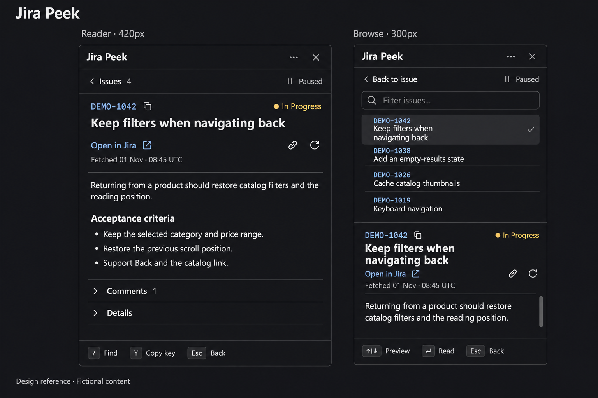

# Native Mods research

## Reader follow-up — 3 November 2026

The private field review found useful vertical savings from the icons but
identified reader obstruction, moving load targets and ambiguous wrapped tables.
Its real issue data is not copied into this repository; the offline catalog
fixtures reproduce those interaction patterns with entirely fictional content.

- [VS Code view actions](https://code.visualstudio.com/api/ux-guidelines/views#view-actions)
  informs the compact toolbar grouping.
- [Carbon tooltip guidance](https://www.carbondesignsystem.com/building-blocks/core/components/tooltip/guidelines)
  supports making optional action descriptions available on hover and focus.
  Herdr's native tooltip is pointer-only, so focused icons use an existing,
  reserved hint region with an explicit action name and shortcut.
- [Atlassian typography](https://atlassian.design/foundations/typography/)
  supports readable text and hierarchy. Fully displayed paragraphs need no
  duplicate text tooltip; clipped header values retain their previews.
- [GOV.UK tables](https://design-system.service.gov.uk/components/table/)
  explains tables through explicit row and column headers. Peek's narrow
  plain-text projection repeats column names beside values. This is a local
  adaptation, not a claim that GOV.UK prescribes this exact rendering.

Known summaries occupy the final title slot before details arrive. Short-panel
titles still scroll with the body. Unknown pinned headings keep Open/Copy link
disabled until their final position is available. Merged-cell tables preserve
visible text and explain that Jira is needed for column relationships.

## Visual hierarchy reference — 3 November 2026

This generated board is the visual reference used for the layout pass. It
addresses grouping and hierarchy beyond the earlier icon substitution. It is
a proposal, not a screenshot of the implemented app or native QA evidence.
The 420px/300px captions describe intended viewports; generated proportions
are approximate. Validate actual geometry in the native fixture.

**User constraint: no neon, glowing selection rails, decorative colored side
bars, or ornamental header bars.** The initial generated treatment was rejected.
Use a flat neutral selection fill and a small checkmark; use ordinary focus
feedback for keyboard navigation. Semantic link and status colors remain useful.

| Region | Reference decision | Purpose |
| --- | --- | --- |
| Panel header | Plain Jira Peek title, grouped overflow and close controls. Overflow leads to Options, with a named Help entry. | Keep panel management separate from issue actions. |
| Navigation | Issues/count or Back to issue on the left; Following/Paused stays labeled on the right. | Show where the user is and whether incoming keys can change selection. |
| Issue heading | Key with inline copy, status, prominent title, then one aligned action row. | Let identity and title lead the reading hierarchy. |
| Issue actions | Open in Jira remains a clear text action with an external-link icon. Copy-link and Refresh form the trailing group; fetch time sits directly below. | Keep related actions together and remove the detached icon row. |
| Reader | Readable paragraphs, restrained section headings, labeled Comments/Details disclosures. | Reduce repeated labels and outlined controls around the content. |
| Browse | Filter, bounded issue list, separator, then the same selected-issue heading and reader. | Preserve context while previewing without filling the panel with controls. |

Implementation should retain 16px glyphs in at least 32px targets, consistent
4/8px spacing, native focus, accessible names and concise tooltips. Narrow
titles wrap; font size stays readable. Treat the default Summary as the issue
title and avoid repeating its label, while honoring custom field placement,
labels and visibility. Keep the last successful fetch time visible and retain
the existing focus-dependent shortcut hints and scroll-position behavior.
The implementation follows these groups. Below 500px panel height, the title
scrolls with the content to keep the identity/actions and reader usable; the
short result list reserves less height. The title uses the configured UI size
plus two logical pixels, and the rest inherits the UI size. The native host's
theme tokens and font settings govern actual rendering;
do not copy generated texture, gradients or keycap sheen into the product.

The final **1536×1024** PNG was generated with the built-in image tool from
the repository's fictional fixture screenshot, then refined for the user's
no-neon direction. Only the final selected image is stored here. Its PNG
contains image data and `caBX` provenance, with no EXIF or text chunks.
[Reusable generation brief](design/jira-peek-polish-v1-prompt.txt) includes the
final constraint; [exact final edit prompt](design/jira-peek-polish-v1-edit.txt)
records the correction used. The image itself is design evidence; see
[layout verification](VERIFICATION.md#composed-layout-and-local-update) for
the implementation and device update checks.

## Action icons — 3 November 2026

The [official Herdr guide](https://herdr.dev/guide/) identifies the installed
guide and type files as the version-matched API reference. This pass read
herdr-app **0.1.12**'s generated `AGENTS.md` and `gpui-kit.d.ts`, and fetched
the following official source at tag `v0.1.12`, commit
`4aa3460749947e7771aa39a8a2cec58d46649926`:

| Reference | Observed pattern | Application to Peek |
| --- | --- | --- |
| [Workspace chrome](https://github.com/herdrdev/herdr-app/blob/4aa3460749947e7771aa39a8a2cec58d46649926/defaults/mods/workspace-chrome/main.js#L27) | Small monochrome SVGs, muted theme colors, rounded hover backgrounds; labels remain on expanded navigation rows. | Quiet icon buttons for common actions, with visible labels for navigation and mode. |
| [Tabs](https://github.com/herdrdev/herdr-app/blob/4aa3460749947e7771aa39a8a2cec58d46649926/defaults/mods/tabs/main.js#L53) | 12–16px SVGs; compact close controls; Files/Changes pair icons with labels. | 16px glyphs in 32px targets; retain Issues, Following/Paused, and field labels. |
| Installed `gpui-kit.d.ts`: `svg`, `tooltip`, `accessibility_label` | SVGs resolve from app home and inherit text color. Tooltips are pointer help; accessible names are separate. Native Buttons support both. | Bundle icons under the mod, use native Buttons, preserve focus handles, and provide both names and tooltips. |
| [Apple button guidance](https://developer.apple.com/design/human-interface-guidelines/buttons) | Familiar icons suit familiar actions; text is useful when it communicates more clearly. | Use external-link, chain, refresh, sliders, help, and close icons; keep ambiguous modes and recovery actions explicit. |

These are source/API observations and a design judgment for Peek, not an
official Herdr icon standard. The shipped examples do not consistently supply
accessible names or tooltips; Peek keeps its stronger native Button contract.
No third-party source or icon package was copied. The ten bundled SVGs are
simple original geometry under this repository's license.

The first pass replaces header and issue-action text with icons, retains the
issue key and copy affordance, and gives Comments/Details disclosure chevrons.
A copied key/link changes its glyph to a check without changing control size.
Options retains named action rows, and Help describes the symbols. Status,
fetch time, Follow/Paused, unread counts and return labels remain visible.
See [UX acceptance](UX-REVIEW.md#action-icons) and
[verification](VERIFICATION.md#action-icons) for actual native coverage.

## Catalog and public repositories — 1 November 2026

Rechecked the official [catalog](https://herdr.dev/mods/), its client-side
filter/sort code and its [public index](https://assets.herdr.dev/mods/index.json)
at approximately **06:16 UTC**. The index was generated at
`2026-11-01T06:00:16.399Z`: **111 entries from 98 repositories**. Applying the
page's exclusion of the official example repository gives **110 community
mods from 97 repositories**, plus one example. The feed reports 109 collected
topic repositories, 11 skipped and `truncated: false`. A separate live GitHub
topic search returned 110 repositories across two pages (100 + 10); repository
search results are not the same as indexed mod entries.

The static page initially says Community 0 because JavaScript loads the feed.
That placeholder is not the available-mod count. Popular ordering places cards
with approved preview URLs first, then sorts by repository stars. This pass
derived the count and ordering from the page/feed; it did not observe a browser
render. The five references below all have preview URLs and are the leading
community entries under that ordering. Direct GitHub metadata returned the
same star counts. Stars are attention signals, not user ratings, installations,
endorsements or evidence of correctness; Insights shares stars with its broader
toolkit repository.

| Reference and inspected revision | Stars | Useful practice for Peek |
| --- | ---: | --- |
| [Insights](https://github.com/GaganSD/coding-agent-toolkit/tree/92cdb30bfe5b41b0b25e5a44f2b3965f9811ce24/herdr-insights) | 37 | Separate install and rebuild guidance; ownership-aware updates/removal; explicit local-data scope. |
| [Atuin Threads](https://github.com/atuinsh/herdr-atuin-threads/tree/6e2786d1ae7555cbe4c338c55c265badc86812cb) | 29 | Clear prerequisites, a compact list scoped to the current repository, and a precise description of its resume action. |
| [Automations](https://github.com/DnzzL/herdr-automations/tree/983aec905a49e678d8694a9ca70de77ea3f728c5/app) | 24 | Separate the native `app/` entry from the TUI plugin and explain the extra scheduler/service dependency. |
| [Greenflagged](https://github.com/greenflagged/herdr-greenflagged/tree/60d99ff9f28a8c90da4778665eed5f883a402def) | 9 | A concrete README section explains network payloads, credential lookup, file access and programs run. |
| [Git Graph](https://github.com/rabeeh-ta/herdr-git-graph/tree/1cfcff364e4796feabdd8f396feb61a1213b3c45) | 7 | State tested host/platform and known limits; separate pure logic from native UI; distinguish reads from actions that change a repository. |

All five inspected repositories contain MIT licenses. No third-party source
was copied, installed or executed. The comparison used README/recipe/metadata
and selected implementation files, not full runtime or security audits.

### What the source adds to the README claims

- Insights' [installer](https://github.com/GaganSD/coding-agent-toolkit/blob/92cdb30bfe5b41b0b25e5a44f2b3965f9811ce24/herdr-insights/scripts/install.mjs)
  checks file ownership, but runs its native check after writes. Keep Peek's
  existing validation-before-replacement and backup behavior. Its
  [lifecycle code](https://github.com/GaganSD/coding-agent-toolkit/blob/92cdb30bfe5b41b0b25e5a44f2b3965f9811ce24/herdr-insights/mods/insights/main.js#L509)
  also makes cleanup and stale-result guards explicit.
- Atuin's [source](https://github.com/atuinsh/herdr-atuin-threads/blob/6e2786d1ae7555cbe4c338c55c265badc86812cb/mods/atuin-threads/main.js#L78)
  caps the initial query at 80 sessions before repository filtering and launches
  `atuin threads resume` for activation. Its in-memory panel does not imply that
  the wider Atuin workflow is offline or stores no transcripts. Keep Peek's
  bounds and backend/cache distinctions visible too.
- Automations' [app recipe](https://github.com/DnzzL/herdr-automations/blob/983aec905a49e678d8694a9ca70de77ea3f728c5/app/RECIPE.md)
  and [form implementation](https://github.com/DnzzL/herdr-automations/blob/983aec905a49e678d8694a9ca70de77ea3f728c5/app/mods/automations/main.js#L176)
  connect a progressive panel to an external service and guard late form
  previews. Peek should document its own external tools without adopting
  scheduling or agent-execution scope.
- Greenflagged's [disclosure](https://github.com/greenflagged/herdr-greenflagged/blob/60d99ff9f28a8c90da4778665eed5f883a402def/README.md#what-it-does-on-your-machine)
  explicitly includes private package names in outbound data; its
  [request builder](https://github.com/greenflagged/herdr-greenflagged/blob/60d99ff9f28a8c90da4778665eed5f883a402def/mods/greenflagged/audit.js#L73)
  exposes those fields. This is a useful disclosure pattern, not a reason to
  reuse its credential lookup or network behavior.
- Git Graph's [README](https://github.com/rabeeh-ta/herdr-git-graph/blob/1cfcff364e4796feabdd8f396feb61a1213b3c45/README.md#limits)
  limits its testing claim to macOS/herdr-app 0.1.9. Its
  [Git helper](https://github.com/rabeeh-ta/herdr-git-graph/blob/1cfcff364e4796feabdd8f396feb61a1213b3c45/mods/git-graph/git.js#L7)
  uses explicit argument arrays and read flags. Keep Peek's stock-host behavior
  and optional renderer build clearly separated in support claims.

### Changes applied and publication boundary

The local review corrected the 0.11.0 recipe to 0.13.0, made its complete-checkout
installation explicit, qualified optional shortcuts, refreshed the stock-host
preview, clarified credential storage and tested platforms, and added native
contributor/publication guidance. These are documentation and presentation
changes; no runtime or dependency was changed for this comparison.

At this research checkpoint, GitHub metadata showed the original
[TUI repository](https://github.com/hilmimuktitama/herdr-jira-peek) was public,
with `herdr-plugin`, `jira` and `terminal` topics; its default branch had no
native `app/` directory and its latest release was TUI `v0.4.3`. No publication
or external mutation was performed during that research.

Following that research, the native edition was extracted and published as
[herdr-app-jira-peek](https://github.com/hilmimuktitama/herdr-app-jira-peek), with
its own root catalog entry, complete runtime and v0.13.0 source release.
That is historical delivery evidence. The later experimental 0.1.0 checkpoint
resets the Git history and retires that release while keeping the repository
private; catalog indexing is not confirmed.
See [publication steps](../RELEASING.md) and
[current candidate validation](VERIFICATION.md#experimental-010-readiness).

The older dated observations below remain historical evidence.

## Help references — 1 November 2026

The [official Herdr guide](https://herdr.dev/guide/) points to the installed
`AGENTS.md` and type files as the version-matched authority. herdr-app 0.1.10's
`gpui-kit.d.ts` documents tooltips as pointer-only strings, supported directly
on native buttons and plain layout elements. Other controls need a wrapper;
tooltips do not replace accessible names. The shipped `help/main.js` and its
rendered Keybinds screen provide a grouped help view with keyboard access and
Escape dismissal.

For Jira Peek, the resulting design choice is short optional tooltips plus a
header Help button that opens guidance for the current screen in the attached
panel. Common questions are answered locally; setup and connection help link to
the specific [Atlassian API token guide](https://support.atlassian.com/atlassian-account/docs/manage-api-tokens-for-your-atlassian-account/).
This is an application of Herdr's API contract and native examples, not a
claim that Herdr prescribes a particular Help button placement. The help copy
ships with the mod and requires no website or account to read.

## Options references — 1 November 2026

Computer Use compared Jira Peek 0.9.2 with the installed herdr-app 0.1.10 **New**
menu and **Settings → Look**. The New menu uses aligned rows, trailing hints,
muted unavailable actions, and separators. Settings groups labels and controls
without making every choice an outlined pill. The installed `menu/main.js`
and [official new-menu source](https://github.com/herdrdev/herdr-app/blob/master/defaults/mods/new-menu/main.js)
confirm the roughly 31px row pattern. This is direct visual and source evidence,
not a popularity claim.

[Apple's menu guidance](https://developer.apple.com/design/human-interface-guidelines/menus)
recommends concise action labels, related groups, visible unavailable states,
clear toggle state, and sparing submenus. The official Markdown representation
was read because the HTML page requires JavaScript. The application here is a
design judgment: a short Options list suits these mixed commands better than
wrapping pills. Peek retains native buttons/toggles and its attached placement.

| Before | Intended improvement | Why |
| --- | --- | --- |
| Commands, state, and navigation share wrapping outlined pills. | Aligned rows, separators, explicit on/off values, and a Connection chevron. | Position and appearance communicate each control's role. |
| Options compresses its controls into a small nested scroll area. | A temporary Options view uses the existing panel's available height. | Secondary commands are easy to scan; closing restores the issue view. |
| Connection → Back closes Options. | Return to Options with Connection focused. | Back retraces the visible path. |
| Canceling setup always opens Connection settings. | Return to the screen that opened setup. | First-time setup and nested setup have different parents. |

Implementation and native acceptance are recorded in [UX-REVIEW.md](UX-REVIEW.md).

## Mods catalog — 31 October 2026

The rendered [Herdr Mods catalog](https://herdr.dev/mods/) listed **86 community
mods and one example**, inspected with Computer Use around 16:40–16:49 UTC.
All 86 entries appeared in the accessibility tree. Its sort menu offered
**Popular** and **New**. The initial plain-text web fetch returned the empty
loading shell; that is not evidence of an empty catalog.

## Popularity evidence

These were the first three entries under Popular. GitHub repository metadata
independently returned the same star counts during the research session.

| Catalog entry | Repository stars | Observed purpose |
| --- | ---: | --- |
| [Insights](https://github.com/GaganSD/coding-agent-toolkit/tree/main/herdr-insights) | 36 | Summarizes local coding-agent usage across four providers. |
| [Atuin Threads](https://github.com/atuinsh/herdr-atuin-threads) | 29 | Finds captured sessions in the current repository and resumes one. |
| [Automations](https://github.com/DnzzL/herdr-automations/tree/main/app) | 23 | Shows scheduled agent runs and their results beside the work. |

These are repository-level attention signals, not installs, unique users,
favorites, satisfaction, or growth rates. Insights lives within a broader
toolkit repository. Neither the rendered native catalog nor the inspected
metadata established which individual mod is most used or trending.

**Inference from their design:** each gives a clear answer to a frequent task,
reuses existing work context, and exposes a direct next action. Insights has
local-data privacy and explicit loading/error states; Atuin scopes its list to
the current repository; Automations makes completed and failed runs visible
in an attached panel. These are plausible strengths, not measured causes of
their star counts. No third-party mod was installed or executed for this study.

## Comparable tools and construction

| Reference inspected | Useful construction detail | Fit for Peek |
| --- | --- | --- |
| [Linear](https://github.com/dantech99/herdr-linear/blob/main/mods/linear/main.js), 1 star | Native `InputState` filtering, compact issue rows, generation checks for asynchronous loads. | Immediate lookup and predictable current context. Its Agent/worktree workflow has a different scope. |
| [GitHub panel recipe](https://github.com/obrunogonzaga/herdr-mods/blob/main/github-panel/RECIPE.md), 1 repository star | PR/issue rows show title, state and age; stale results are discarded after context changes. | Keep the issue glance concise and preserve source identity. |
| [Linear board](https://github.com/nu0ma/herdr-linear-board) catalog card | State columns, project/text filters, browser and agent actions. | Comparable issue workflow, but a board is too broad for Peek. Only its catalog description was inspected. |
| [quick-switcher](https://github.com/frizynn/quick-switcher/blob/main/mods/quick-switcher/main.js) | Clones Herdr's picker: native input, local arrow handling, Enter submission and a virtual list. | Direct reference for typing → arrows → preview → Enter. No star count was displayed on its catalog card. |
| [Insights UI](https://github.com/GaganSD/coding-agent-toolkit/blob/main/herdr-insights/mods/insights/ui.js) and [recipe](https://github.com/GaganSD/coding-agent-toolkit/blob/main/herdr-insights/RECIPE.md) | Native buttons, semantic theme colors, clear primary action and explicit data states. | Reinforces existing native controls and restrained hierarchy. |
| [Atuin source](https://github.com/atuinsh/herdr-atuin-threads/blob/main/mods/atuin-threads/main.js) | Context-scoped compact rows and relative ages. | Useful density reference; relative fetch age was rejected for Peek because an idle label can become stale without repainting. |
| [Automations recipe](https://github.com/DnzzL/herdr-automations/blob/main/app/RECIPE.md) | Attached panel, compact status, progressive list/detail/form views. | Reinforces attached placement and optional depth. Scheduling and execution controls do not belong in Peek. |

The installed official herdr-app **0.1.10** `mods/picker/main.js` was also inspected:
its parent handles Up/Down while the native input retains focus. That host
implementation, rather than community popularity, supplies the integration
precedent. Peek keeps its existing edge clamping and modifier guards.

Source snapshots used these Git blob SHAs (not release or commit identifiers):

| File | Blob SHA |
| --- | --- |
| quick-switcher `mods/quick-switcher/main.js` | `c6682ca9a6a846aaa32ddbb5283b9b896e7acc95` |
| Linear `mods/linear/main.js` | `30f02a3d7463f378d8dfda6115888159218e9ec8` |
| Atuin `mods/atuin-threads/main.js` | `6a775d8d047b264a5ad459ae131b7e5557405c63` |
| Insights `herdr-insights/mods/insights/ui.js` | `dec015d3e83302f3cc383235f6426ca3b6219161` |
| GitHub `github-panel/RECIPE.md` | `eeb399471e1919554f3c8b441e336f0383419eb6` |
| Automations `app/RECIPE.md` | `079162d869cff6ebf3490457838690d83230801f` |

## Applied in 0.8.0

| Before | After | Why |
| --- | --- | --- |
| Arrows in search did not choose results. | Plain Up/Down changes the preview while focus stays in search. | Removes the detour through Tab or a pointer; typing can continue immediately. |
| Search Enter chose the first result even when a different visible row was selected. | Input and list Enter choose the same highlighted result. | The visible choice predicts the action. |
| List Down could skip the first result after filtering out the old selection. | The first arrow starts at the first visible result. | Filtering has a predictable starting point. |
| Direct search relied on a preceding render to remember its origin. | Search captures the live origin before moving focus. | Return does not depend on event ordering. |

The panel stays attached and uses the existing issue-loading path, native
input and virtual list. No new global shortcuts, dependencies, timers,
authentication behavior, or Jira mutations were introduced. Exact fetch
timestamps remain truthful while idle. See [native acceptance](UX-REVIEW.md)
and [verification](VERIFICATION.md) for implementation evidence and limits.
